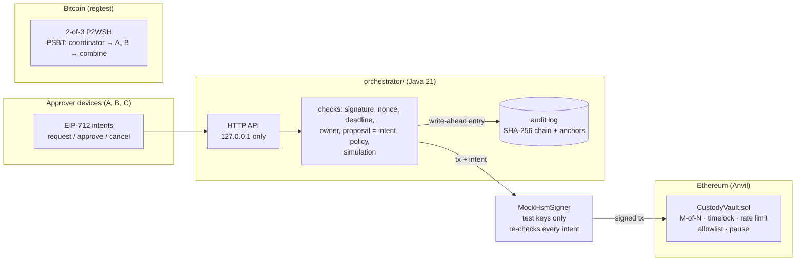

# Custody Vault

[](https://github.com/goldentree831120-ui/custody-vault/actions/workflows/ci.yml)

A small model of an institutional custody stack. An Ethereum **multisig vault** enforces policy
on-chain (M-of-N approvals, timelocks, rate limits, a destination allowlist, an emergency pause).
A **Java signing orchestrator** turns approvers' signed requests into vault transactions through
a mock HSM that doesn't trust it, and records every decision in a **tamper-evident audit log**.
A **Bitcoin 2-of-3 multisig** shows the same idea where the rule lives in the script instead of a
contract.

**Local only:** everything runs on local chains (Anvil, Bitcoin regtest) with public
test keys. Nothing is deployed, no real funds are involved, and the HSM is a mock.



| Part | What | Docs |
|---|---|---|
| `src/`, `test/` | The vault contract (Solidity 0.8.26, Foundry, OpenZeppelin 5.1) and its unit, fuzz and invariant tests | below |
| `docs/THREAT_MODEL.md` | Assets, actors, attack paths, controls, residual risks; ⚖️ marks judgement calls | [threat model](docs/THREAT_MODEL.md) |
| `docs/SLITHER_TRIAGE.md` | Static analysis (Slither, Foundry lint): every finding and the decision on it | [triage](docs/SLITHER_TRIAGE.md) |
| `orchestrator/` | Signing orchestrator, mock HSM, hash-chained audit log (Java 21, one dependency) | [orchestrator](orchestrator/README.md) |
| `bitcoin/` | 2-of-3 P2WSH multisig spent with PSBTs on regtest (Bitcoin Core 31.1) | [bitcoin](bitcoin/README.md) |

## Run it

On Windows, use WSL. Needs Foundry; the orchestrator needs Java 21 + Maven; the Bitcoin part
needs `jq` and downloads Bitcoin Core (about 50 MB). All free; nothing leaves the machine except
the downloads.

```bash
git clone https://github.com/goldentree831120-ui/custody-vault && cd custody-vault
git submodule update --init --recursive        # forge-std v1.17.0, OpenZeppelin v5.1.0
forge test                                      # 35 unit/fuzz tests + 7 invariants
./script/mutation-check.sh                      # plants 6 bugs in the vault; each must be caught
(cd orchestrator && ./demo.sh)                  # vault + orchestrator + mock HSM + audit log on Anvil
(cd orchestrator && mvn test)                   # 69 unit tests + the end-to-end test
./bitcoin/install-bitcoin-core.sh               # checksum-verified download into ~/.local/opt
BITCOIN_BIN=~/.local/opt/bitcoin-31.1/bin ./bitcoin/regtest-multisig.sh
```

## Results

Only results that were actually produced, and where. Laptop: Intel Core i5-10210U, 8 GB RAM,
Windows + WSL Ubuntu. CI: GitHub Actions `ubuntu-24.04` runners.

| What | Result | Where |
|---|---|---|
| Vault tests (35 unit/fuzz + 7 invariants; 256 runs × 100 calls per invariant) | all pass (newer Foundry reports 36: the invariants are grouped) | laptop, CI |
| Vault mutation check: 6 planted bugs | 6/6 caught; [`docs/mutation-report.txt`](docs/mutation-report.txt) names the catching invariants | laptop, CI |
| Slither 0.11.6 | 0 High/Medium; 5 Low reviewed and annotated; CI fails on any new Low+ | CI |
| Orchestrator: unit + end-to-end on Anvil | 69 + 1 pass (the end-to-end test can't be skipped in CI) | CI |
| Orchestrator mutation check: 19 planted bugs in the orchestrator, signer, signature parsing and audit log | 19/19 caught | CI |
| End-to-end demo: withdrawals, timelock, 8 refusals, 3 signer refusals with the orchestrator bypassed, a veto, the audit log and 5 tampering attempts | 29/29 checks | laptop, CI |
| Audit log of that run | 61 entries verified; 10 of 10 transactions had a write-ahead entry; 17 of 17 logged approver signatures still verify | laptop |
| Signing code vs an independent implementation | EIP-712 signature and signed EIP-1559 transaction byte-identical to Foundry's `cast` | CI (unit test) |
| Bitcoin 2-of-3 PSBT scenario | 31/31 checks | laptop, CI |
| CI wall time per job | vault tests 1m26s · Slither 36s · orchestrator 3m41s · Bitcoin 13s | CI |

## How a withdrawal works

```
 approver A (device)        approver B (device)                         any time before execute
 signs WithdrawalRequest    signs WithdrawalApproval                     one approver: Cancellation
        │                          │ (names id, asset, to, amount)
        ▼                          ▼
 orchestrator: verify, check vault state, simulate, log ──▶ mock HSM re-checks, signs owner tx
        │                          │
        ▼                          ▼
 vault: proposeWithdrawal ──▶ approve (M reached) ──▶ [timelock if large] ──▶ execute
   not paused, allowlisted,                            M approvals from current owners,
   amount <= daily limit                               timelock passed, not paused,
                                                       still allowlisted, bucket has room
```

Configuration changes (owners, threshold, allowlist, limits, unpause) go through
`proposeConfig(calldata)`: **always** timelocked, and the calldata can only target the six
`onlySelf` functions. There is no admin key and no upgrade path.

## Key decisions

| Decision | Why | Trade-off |
|---|---|---|
| Any single owner can `cancel` and `pause`; unpausing needs M-of-N + timelock | One honest owner can stop M stolen keys during the timelock | ⚖️ One dishonest owner can freeze the vault: **safety over liveness** ([threat model §4.6](docs/THREAT_MODEL.md)) |
| **Token-bucket** rate limit; new assets start empty; lowering a limit applies at once, raising it refills gradually | A fixed daily window lets 2× the limit out across midnight; a bucket never holds more than one day's limit | Slightly more state; first withdrawal of a new asset waits |
| Timelock applies if a withdrawal was large when proposed **or** is large now | Policy changes can make pending withdrawals stricter, never looser | |
| Approvals are on-chain; off-chain EIP-712 intents only in front, at the orchestrator | The contract has no signature-replay surface | Gas per approval |
| **The signer doesn't trust the orchestrator** | An application-server breach must not become a key breach | The signer needs its own policy and replay state |
| Approval intents carry the content (asset, to, amount), checked against the chain | Approvers can't be tricked into approving "proposal 7" when 7 is something else | Larger intents |
| **Write-ahead** audit entry before every signature; refuse to start on a broken log | Every signature is accounted for; tampering stops the service instead of being ignored | A full disk stops signing (fail closed) |
| Audit **anchors** in addition to the hash chain | A chain can't detect truncation or a fully recomputed log; anchors stored elsewhere can | Only as strong as where the anchors are kept |
| Minimal dependencies in the orchestrator (Bouncy Castle only), encodings pinned to `cast` vectors | Every signed byte is visible and tested | More code to own than using web3j |

All the vault's design decisions, with their trade-offs, are in the [threat model](docs/THREAT_MODEL.md).

## How the tests were checked

Passing tests prove little if they'd also pass with the bug present, so each layer has a
**mutation check**: a script plants one bug at a time and requires a failing test.
- **Vault:** 6 bugs, e.g. ignore the threshold, skip the timelock, uncap the rate-limit bucket,
  drop the allowlist check, ignore pause.
- **Orchestrator:** 19 bugs, e.g. skip the nonce or expiry check, don't compare calldata with the
  intent, accept high-s signatures, don't write the audit entry before signing, ignore anchors.

What these found:
- **First vault test suite:** removing the bucket cap passed every invariant. The cumulative bound
  still held, which is why `invariant_noBurstBeyondBucket` (a sliding-window check) exists.
- **Threshold check:** removing only the threshold check was hidden by the timelock gate. It's
  caught by unit tests, not invariants.
- **M7 review:** the burst invariant caught an uncapped bucket in only 3 of 10 seeded runs
  (seeds 11–20, measured during development), because random call sequences rarely sit idle for
  days and then withdraw quickly. One earlier mutation report showed it catching the bug, which was
  a lucky (or replayed: Foundry **re-runs saved counterexamples**) run. A targeted handler action (`idleThenBurst`) now catches it
  in 10 of 10 (`script/burst-catch-rate.sh` reproduces this), and the mutation script clears saved
  counterexamples between bugs so one bug's failure can't be replayed as another's.
- **Bitcoin tamper test:** the first version was rejected for the wrong reason (outputs exceeded
  inputs). It now keeps the total unchanged and requires a signature failure.

`test/invariant/` drives random sequences of propose / approve / revoke / cancel / execute /
pause / unpause / time jumps across 5 owners (threshold 3). The handler keeps its **own model** of
approvals and timelocks, built only from calls that succeeded, and checks the vault against it:

| Invariant | Meaning |
|---|---|
| `noExecutionWithoutMApprovals` | every executed proposal had M approvals from current owners (by the model's count); the outsider never executed anything |
| `withdrawalsNeverExceedRateLimit` | total outflow per asset `<= dailyLimit * days since policy set` |
| `noBurstBeyondBucket` | for any window between two withdrawals, outflow `<= limit + refill during the window` |
| `largeWithdrawalsRespectTimelock` | large withdrawals never ran before M approvals + delay |
| `nothingExecutesWhilePaused` | |
| `onlyAllowlistedDestinationsReceiveFunds` | outsider, owners and the non-allowlisted address never received anything |
| `conservation` | vault + destinations always equals deposits |

## Limitations

- **Mock HSM, public test keys.** `MockHsmSigner` holds Anvil's published keys in memory and
  refuses any chain but 31337. It demonstrates the interface and the policy, not key security.
  All three owner keys are in one process, which a real deployment must never do.
- **Not deployed, not audited, not formally verified.** The guarantees are what the tests,
  invariants and mutation checks show.
- **Out of scope for the vault:** fee-on-transfer, rebasing and blocklisting tokens; upgradeability.
- **Orchestrator:** no authentication or TLS on the API (bound to localhost); one instance; no fee
  bumping or reorg handling; audit anchors kept in a local file in the demo.
- **Bitcoin:** plain multisig has no timelock, rate limit, allowlist or pause. Keys reuse each
  wallet's BIP 84 account (as in Bitcoin Core's multisig tutorial) instead of a BIP 48 path.

## Repository layout

```
src/CustodyVault.sol        the vault
test/                       unit + fuzz tests; invariant/ (handler + invariants); utils/
script/                     mutation-check.sh (6 vault bugs), burst-catch-rate.sh
docs/                       THREAT_MODEL.md, SLITHER_TRIAGE.md, mutation-report.txt
reports/slither.txt         raw Slither output
orchestrator/               Java 21: intents, checks, mock HSM, audit log, HTTP API, demo, tests
bitcoin/                    regtest 2-of-3 PSBT scenario + Bitcoin Core installer
.github/workflows/ci.yml    4 jobs: vault tests + mutation check, Slither, orchestrator, Bitcoin
```
